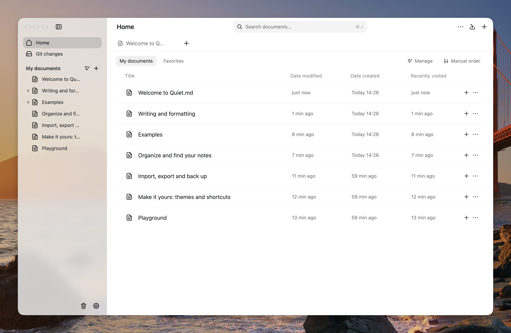

<h1 align="center">Quiet.md</h1>

  <b>一个又快又安静的本地笔记应用。</b> 
  Rust + GPUI 原生绘制，笔记全部存在你的电脑上，兼容飞书文档的 DocxXML 格式。

  <a href="README.md">English</a> · 简体中文 · <a href="README.ja.md">日本語</a> · <a href="README.ko.md">한국어</a> · <a href="README.es.md">Español</a> · <a href="README.fr.md">Français</a>

  
  
  
  
  
  

  
  &nbsp;
  
  &nbsp;
  

  <a href="https://quiet.md"><b>官网</b></a> ·
  <a href="#下载"><b>下载</b></a> ·
  <a href="#性能">性能</a> ·
  <a href="#功能">功能</a> ·
  <a href="CONTRIBUTING.md">参与开发</a>

  

> [!NOTE]
> 遇到 bug 或有想法，欢迎[提 issue](https://github.com/s1dashu/quiet-md/issues)，更欢迎直接提 PR，一起把它打磨好。

## 为什么是 Quiet.md

**⚡ 快，原生的那种快。** 整个界面由 Rust 和 [GPUI](https://www.gpui.rs/) 直接用 GPU 绘制，没有 WebView、没有 Electron。百万字文档实测中，输入、删除和滚动的帧处理 P95 均低于 6 ms。

**🔒 本地优先，文件归你。** 没有账号，没有云端，默认不联网。文档库就是电脑上的一个普通文件夹：侧栏文件夹是虚拟的，`quiet.json` 管理层级和显示标题，正文固定存放在 `Notes/<UUID>.xml` 或 `.md`。图片、文件附件和画板源文件分别存放在库根目录的 `Images/`、`Files/` 和 `Drawings/`。移动、重命名只修改元数据。用 Git、iCloud、坚果云或任何同步工具管理都可以，哪天不用了，文件也还在。

**📝 兼容飞书 DocxXML，完整的富文本编辑器。** 笔记直接以飞书文档的 DocxXML 格式保存，从飞书复制粘贴、导入导出都能保留结构。标题、待办、表格、分栏、高亮块、代码、公式、图片和附件，写文档常用的块都有。

## 下载

  
  &nbsp;
  
  &nbsp;
  

| 平台 | 安装包 | 系统要求 |
|---|---|---|
| **macOS**（Apple Silicon） | [quiet-md-macos-arm64.zip](https://github.com/iuxt/quiet-md/releases) | macOS 13 及以上 |
| **Windows**（x64） | [quiet-md-windows-x64-setup.exe](https://github.com/iuxt/quiet-md/releases) | Windows 10 1809 及以上 |
| **Linux**（x86_64，实验性） | [quiet-md-x86_64.AppImage](https://github.com/iuxt/quiet-md/releases) | glibc 2.35 及以上（Ubuntu 22.04 及更新） |
| **macOS**（Intel） | [quiet-md-macos-x86_64.zip](https://github.com/iuxt/quiet-md/releases) | macOS 13 及以上 |

- **macOS**：解压后把 `quiet.md.app` 拖进「应用程序」。安装包采用 ad-hoc 签名，未经 Apple 公证。
- **Windows**：运行安装程序，默认只装到当前用户目录，卸载不会删除笔记。如果首次运行出现 SmartScreen 提示，点「更多信息 → 仍要运行」即可。
- **Linux**（实验性）：`chmod +x quiet-md-*.AppImage` 后直接运行；没有 FUSE 时加 `--appimage-extract-and-run`。新版本需手动下载安装。目前只在 Omarchy（Wayland）上做过交互测试，详见 [Linux 说明](CONTRIBUTING.md#linux-experimental)。

当前提供 [iuxt/quiet-md Releases](https://github.com/iuxt/quiet-md/releases) 上的**正式版**：macOS 使用 ad-hoc 签名且未经 Apple 公证，Windows 安装包未签名。请手动下载安装；每个包附带 SHA-256 校验文件。详见[发布说明](docs/RELEASES.md)。

首次启动时可以选择界面语言、文档库位置和随手记快捷键，并可从 Obsidian、Logseq、iA Writer、Typora 复制已有笔记进来。已有的笔记不会被覆盖。

界面支持简体中文、英文、日文、韩文、西班牙文、法文和阿拉伯文。

## 性能

在一篇 **100 万字**、549 章的混合文档里连续操作 100 次，统计每帧处理耗时：

| 操作 | P50 | P95 |
|---|---:|---:|
| ⌨️ 连续输入 | **5.06 ms** | 5.78 ms |
| ⌫ 连续退格 | **4.99 ms** | 5.55 ms |
| 🖱️ 连续滚动 | **2.08 ms** | 4.14 ms |

120 Hz 屏幕每帧的预算是 8.3 ms，百万字文档下的 P95 也留有余量。

| | |
|---|---|
| macOS 安装包 | 约 18 MB |
| Windows 安装包 | 约 14 MB |
| 运行时 | 无 WebView、无 Electron、无后台服务 |

Apple M5 Pro / 48 GiB，macOS 26.5，Release 构建。测试方法和复现脚本见 [docs/PERFORMANCE.md](docs/PERFORMANCE.md)。

## 功能

- **Git 备份**：打开尚无仓库的文档库时，Quiet.md 会初始化本地 Git。可在设置 › Git 备份与同步中配置提交作者和远端，手动提交和同步，在版本历史中查看提交。图片、附件和画板使用内置 Git LFS。详见 [Git 指南](docs/GIT.md)。

- **编辑**：标题、有序 / 无序列表、待办、引用、代码块（语法高亮）、LaTeX 公式、表格（可合并单元格）、高亮块、分栏、图片、附件、封面。支持 `#`、`-`、`[]`、`>` 等 Markdown 快捷输入和 `/` 斜杠菜单。
- 在 DocxXML 笔记中用 `/画板` 插入**画板**。可以绘制图形、箭头、手绘笔迹和文字，也可导入 `.excalidraw`。保存后正文显示预览，点击可继续编辑。画板里的「导出」可以取回可编辑的 `.excalidraw` 文件。
- **版本历史**：保存时自动留下正文快照，每篇默认 20 份（设置 › 文档库里可设为 1–30 份）。右侧抽屉按天列出，点一份即在正文处只读预览那一版，新增与改写的块会着色，可一键恢复，也可以给重要的版本起名字。
- **整理**：文档树、置顶、收藏、全文搜索、回收站。回收站文件夹可以打开，文章可以只读查看并浏览版本历史，恢复后可继续编辑。删除只在 `quiet.json` 中记录回收站状态，原文件留在原路径并一直保留；回收站同样受 Git 管理，不提供自动清理、清空或彻底删除。
- **导入导出**：导入 Markdown 文件夹（含 Obsidian 的图片嵌入和 callout）和飞书 DocxXML；导出 Markdown、PDF，也可以直接打印。可以把文件从访达拖到主页，或直接拖进侧栏的文件夹。从飞书或网页粘贴时保留结构。
- **快捷键**：按 `⌘ /`（Windows 上是 `Ctrl+/`）查看全部快捷键，每一个都能改。快捷键在 Windows 上用 Ctrl 代替 ⌘、Alt 代替 ⌥，应用会按当前系统显示快捷键。
- **主题**：内置 Craft、飞书、Notion、Obsidian 四套风格，也可以用 CSS 自己写，见 [docs/THEMES.md](docs/THEMES.md)。

## 贡献者

感谢每一位参与 Quiet.md 的人。欢迎提 issue 和 PR，构建、测试和代码约定见 [CONTRIBUTING.md](CONTRIBUTING.md)。

## 近期更新

- **0.1.12**（11 月 14 日）：可以把文件从访达、或从「本机文件」直接拖进侧栏的文件夹或两行之间，拖入时整个页面都是放置区；主页卡片改为连续圆角；新增「在访达中打开」；面包屑从「我的文档」开始；窗口最小宽度给文档区留足空间；全屏时侧栏用不透明底色。修复在文件夹里新建文档时可能卡死的问题。
- **0.1.11**（11 月 13 日）：文档库改为真实文件夹，文件以标题命名，旧文档库自动迁移并留有备份；全新的首次启动，可设置语言、文档库位置和随手记快捷键，并从 Obsidian 等 Markdown 应用导入笔记；新增日语、西班牙语和韩语界面；Markdown 支持块级公式；文档回到上次的阅读位置；启动更快、内存更省。
- **0.1.10**（11 月 10 日）：新建菜单可选择文档类型，宽表格支持横向滚动，Markdown 表格保存列对齐，长输入框跟随光标滚动。
- **0.1.9**（11 月 8 日）：修复 macOS ⌘Q 无法退出、Windows 窗口按钮无响应，以及文字背景色遮挡选区的问题。
- **0.1.8**（11 月 9 日）：支持本机 Markdown 原地编辑、保留 `.md` 的文件夹导入、多级文件夹与拖动/撤销；优化图片和预览内存占用，修复表格调宽跳页，统一菜单样式；首次启动选择系统支持的语言，新增实验性 Linux AppImage 打包。
- **0.1.7**（11 月 6 日）：加固多窗口保存、冲突恢复和写盘；限制导出读取文件的范围；Markdown 导出保留行内附件；修复 Windows 小狼毫输入法误删文字。
- **0.1.6**（11 月 6 日）：切回窗口和点击空白后可继续输入，宽表格利用页边空间，持续输入时定期保存；macOS 全局快速笔记改为 ⌥ Space。Windows 支持粘贴图片、导出 PDF 和打印，并修复按词删除。
- **0.1.5**（11 月 5 日）：应用更名为 Quiet.md，文档库位置和已有内容不变。
  - 首页新增批量管理：一次选中多篇文档，创建副本、移动或删除。
  - 回收站可以一键清空；插入菜单的图标可以用方向键移动；删除全部文档后不再自动新建空文档。
  - Windows：快捷键和内置指南显示为 Ctrl / Alt；启动失败时会弹出提示并记录日志。
- **0.1.4**（11 月 5 日）：
  - 深色模式：设置 › 外观 可选跟随系统、浅色或深色，内置主题和自定义主题都有对应的深色效果；导出和打印仍是浅色。
- **0.1.3**（11 月 4 日）：macOS 系统切到深色模式时，侧栏文字不再看不清。
- **0.1.2**（11 月 4 日）：补齐 macOS 的标准菜单和快捷键（隐藏、最小化、缩放、全屏）；关掉最后一个窗口后，点 Dock 图标可以重新打开。修复部分中文字显示成错误字形的问题。
- **0.1.1**（11 月 3 日）：推出 Windows x64 版，按用户安装，卸载时保留笔记；同时完善中英文界面和内置指南。

每个版本的完整说明见 [Releases](https://github.com/s1dashu/quiet-md/releases)。

## 许可

代码使用 [MIT](LICENSE) 许可。第三方代码、字体和素材见 [THIRD_PARTY.md](THIRD_PARTY.md)。

以下内容不在 MIT 范围内，fork 时请替换：

- `assets/icons/` 里的 67 个 Nucleo 图标使用 Nucleo 商业授权，请勿单独提取再分发；
- 「Quiet.md」这个名字和应用图标。
